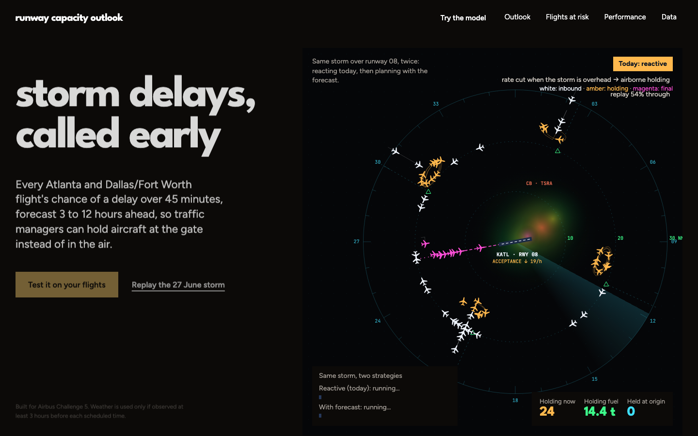
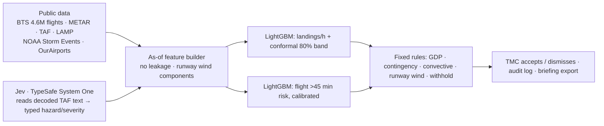
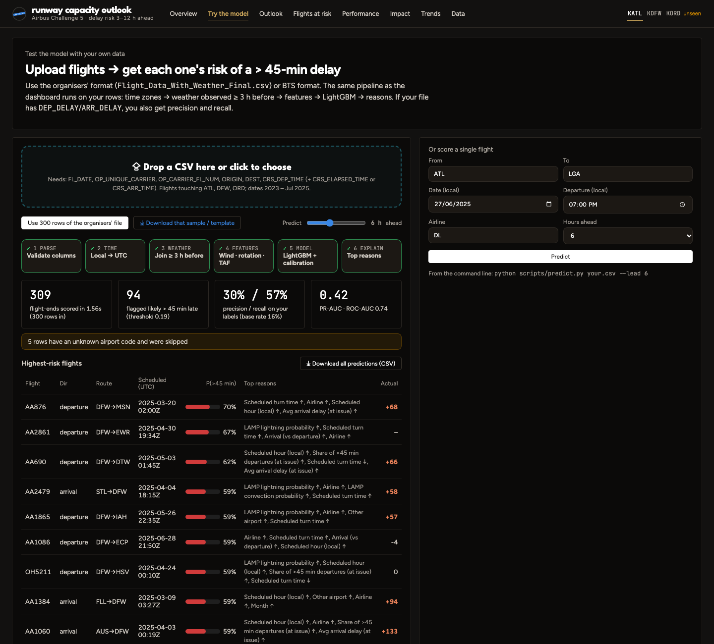
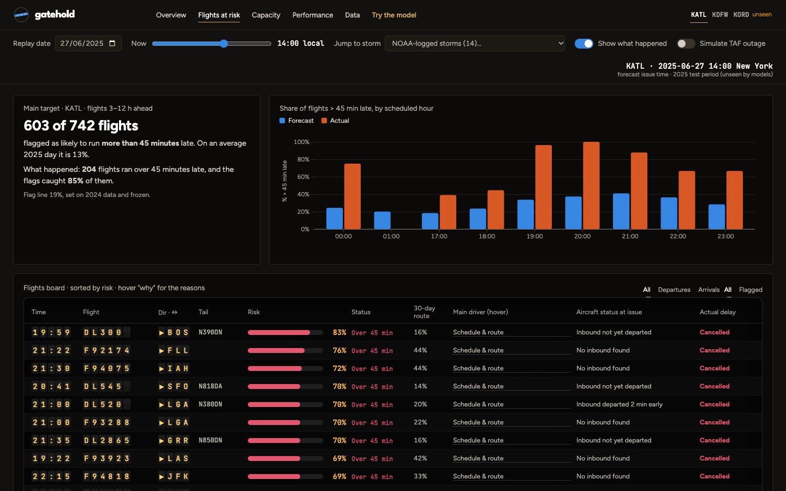
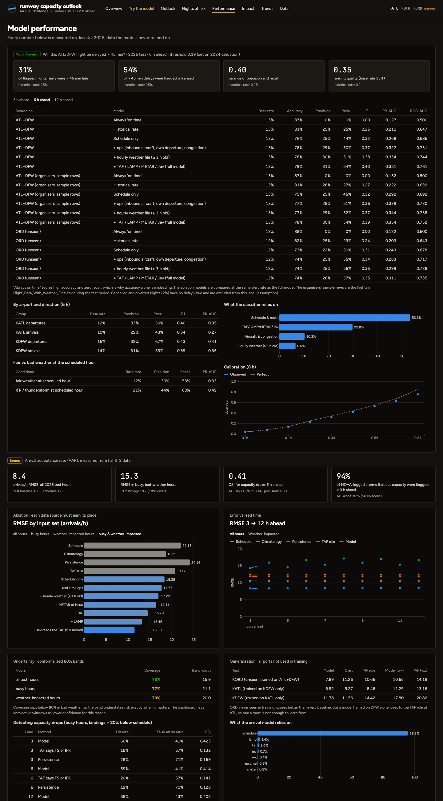
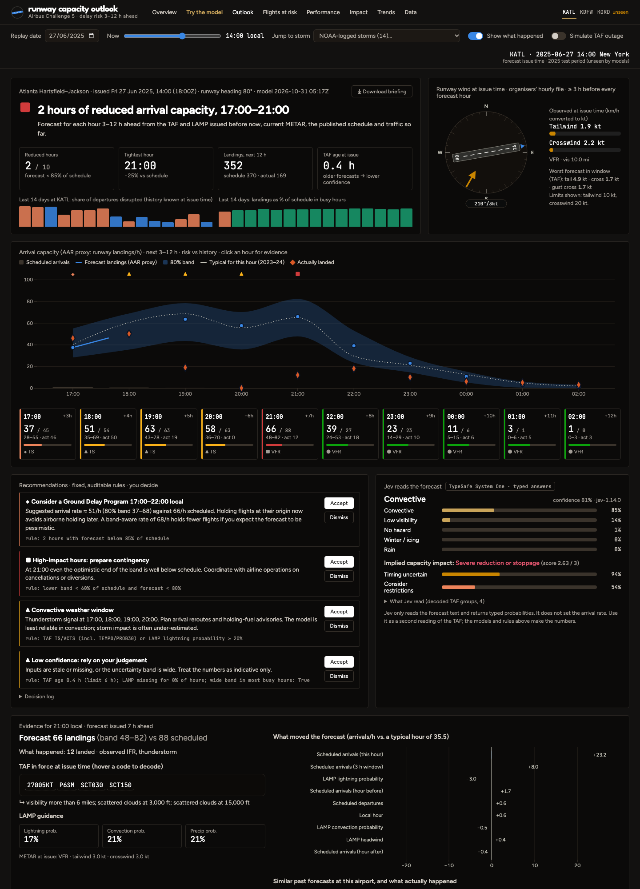

# Gatehold
*Hold them at the gate, not in the sky.*
### Airbus Challenge 5 · Autonomous SG 2026 · *Predictive Airport Capacity & Risk Model*

**Forecast every ATL/DFW flight's risk of a delay over 45 minutes, 3–12 hours ahead, plus the airport's hourly arrival capacity, so the traffic manager can hold flights on the ground instead of in airborne holding.**



| | |
|---|---|
| **User** | Traffic Management Coordinator (TMC) at ATL / DFW, plus the airline operations duty manager |
| **Main target (organisers' update, 31 Oct)** | For every ATL/DFW flight: will it be delayed **> 45 min**? (`DEP_DELAY` for departures, `ARR_DELAY` for arrivals), forecast **3–12 h ahead** using only weather observed **≥ 3 h before** the scheduled time |
| **Bonus** | Hourly arrival acceptance rate (AAR) forecast, scored by RMSE |
| **Try it with your own data** | Web app → **⚡ Try the model** (upload a CSV), or `python scripts/predict.py your.csv --lead 6` |
| **Run everything** | `python scripts/run_pipeline.py` then `python app/server.py` → http://localhost:8600 |


## Run it
```bash
python3 -m venv .venv && .venv/bin/pip install -r requirements-pipeline.txt   # full pipeline; the app alone needs requirements.txt
echo "TYPESAFE_API_KEY=..." > .env                       # optional, enables Jev (git-ignored)
# needs the organisers' Flight_Data_With_Weather_Final.csv in the repo root (included)
.venv/bin/python scripts/run_pipeline.py                 # download → clean → Jev → train/evaluate (~20 min first run)
.venv/bin/python scripts/run_pipeline.py --train KATL KDFW --holdout KDEN   # any ICAO codes
.venv/bin/python app/server.py                           # → http://localhost:8600
```


## Deliverables at a glance

| # | Brief: want to see | Result (Jan–Jul 2025 test, never used for training) | Where |
|---|---|---|---|
| 1 | Multi-source integration | 4.6 M BTS flights + organisers' hourly weather + METAR/TAF/LAMP, joined by airport + UTC hour; organisers' sample rows matched 99.99% | Data page · `src/c5lib.py` |
| 2 | **Delay > 45 min classification (main)** | **Precision 31% · recall 54% · F1 0.40 · PR-AUC 0.35** at 6 h (historical rate: 25% / 25% / 0.21; always-on-time: 87% accuracy, 0% recall). On the organisers' sample rows: PR-AUC 0.35. At 3 h: PR-AUC 0.40 | Flights at risk · Performance · Try the model |
| 3 | AAR by RMSE (bonus) | 8.36 landings/h. Strongest baseline is our own schedule-only model at 9.24 (climatology 10.48, TAF rule 11.82); 26% lower than the TAF rule and 17% lower than schedule-only in busy, bad-weather hours | Capacity outlook · Performance |
| 4 | Interactive ATC dashboard | Risk scores + history + rule-based recommendations, accept/dismiss log, briefing export; 94% of NOAA-logged storms flagged ≥ 3 h ahead | Outlook |
| 5 | Automatic processing | `scripts/run_pipeline.py --train KATL KDFW --holdout <any ICAO>`: downloads organisers' files and all public data, cleans, trains, evaluates | `scripts/` |

**Ablation for the main target** (PR-AUC at 6 h): schedule only 0.27 → + aircraft rotation & congestion 0.33 → + hourly weather file (≥ 3 h old) 0.33 → + TAF/LAMP/METAR/Jev forecasts 0.35. ORD, never trained on: 0.31 (historical rate 0.20).

**How much does weather add?** Honestly, a modest amount overall: +0.024 PR-AUC at 6 h and +0.042 at 12 h (where aircraft rotation tells you less). In IFR/thunderstorm hours the model is much stronger (PR-AUC 0.49 vs 0.33 in fair weather, precision 44%). For capacity, the schedule explains most of the variance; weather and forecasts cut the error a further 10% overall and 17% in busy, bad-weather hours. Jev's reading of the TAF adds almost nothing to accuracy (8.35 → 8.36 RMSE overall, 13.00 → 12.87 in weather hours); it is there to explain the forecast text to the user.

## Is it accurate, and is it over-fitting?
**Scorecard** (main target, 6 h ahead, all ATL/DFW flights Jan–Jul 2025; 95% intervals from 500 bootstrap resamples of test days):

| Accuracy | Precision | Recall | F1 | PR-AUC | ROC-AUC |
|---|---|---|---|---|---|
| 79% (78–80) | 31% (30–33) | 54% (52–56) | 0.40 (0.38–0.41) | 0.35 (0.33–0.37) | 0.76 (0.75–0.77) |

Accuracy is shown, but it is the wrong headline: only 13% of flights are > 45 min late, so "always on time" scores 87% accuracy while catching none of them. Precision and recall are what to judge it on.

**Monte Carlo cross-validation (20 refits)** (notebook §4b). Each refit trains on a random 70% of 2023–24 *days* (whole days, so one storm never sits on both sides), with a new seed, and is scored on its own training days, on the 30% of days it never saw, and on 2025:

| PR-AUC | mean | sd | range |
|---|---|---|---|
| days it trained on | 0.490 | 0.007 | 0.481–0.503 |
| held-out 2023–24 days | 0.333 | 0.017 | 0.302–0.361 |
| 2025 test | 0.350 | 0.002 | 0.346–0.354 |

Reading it honestly: the trees fit their own training days much better than new days (gap 0.16), which is memorisation, so training scores are never quoted. The numbers we report are out-of-sample: unseen 2023–24 days and 2025 agree, and 2025 barely moves between refits (±0.002 PR-AUC; precision 31.0% ± 0.1, recall 53.8% ± 0.2). Stronger regularisation (fewer leaves, larger leaves) might narrow the gap without losing test skill; that is the next experiment.

**Why LightGBM and not XGBoost.** Same rows, features, validation set and early stopping (notebook §4b):

| | PR-AUC | ROC-AUC | Precision / recall at same alert rate | Train time |
|---|---|---|---|---|
| LightGBM (shipped) | 0.355 | 0.761 | 31.3% / 54.3% | 29 s |
| XGBoost (hist) | 0.354 | 0.760 | 31.2% / 54.0% | 123 s |

Accuracy is a tie. LightGBM trains 4.3× faster (which is what makes 20 Monte Carlo refits and the ablations cheap), handles the airline and route categories natively, and gives the exact per-flight contributions shown as "reasons" in the app.

## How the brief is covered

| Brief: want to see | Where |
|---|---|
| Multi-source integration (timestamps + station IDs) | BTS flights ⇄ METAR/TAF/LAMP by ICAO and UTC hour. The provided file was cross-checked against the full BTS data (99.99% matched, delays identical) |
| AAR prediction measured by RMSE | `02_model_capacity_and_delay_risk.ipynb` §5; **Model performance** page |
| Severe-delay (> 45 min) classification (**main target**) | Notebook ★ section; **Flights at risk** board; **Try the model** page and `scripts/predict.py` |
| Dashboard: risk scores + historical trends + recommendations for ATC | **Flights at risk** board (per-flight risk, 30-day route rate); **Capacity outlook** (typical-hour line, 14-day history, rule-based recommendations with triggers); airport comparison on the **Data** page |
| Automatic processing of public datasets | `scripts/download_data.py` and `scripts/run_pipeline.py`: no manual steps, any ICAO codes |

| Brief: want to avoid | How |
|---|---|
| Data leakage across time steps | **3-hour rule** (organisers): weather observed ≥ 3 h before the scheduled time, asserted on every row. Every row has an issue time T = target − lead. Inputs are joined as of T, with asserts on TAF issue time, LAMP run time and METAR hour. We found and documented that the **provided file's weather is mistimed by 4–30 h** (UTC data joined on local time) and do not use it as "current weather" |
| Ignoring runway directionality | Head, tail and crosswind on the brief's headings (ATL 80°, DFW 180°) for METAR, TAF and LAMP winds; runway wind dial in the app |
| Over-fitting to a single airport | Airport-agnostic features scaled by each airport's nominal rate; ORD held out entirely; leave-one-airport-out results reported (incl. where it fails) |
| Un-normalised delays | Rates per flight and per busy hour; delay minutes *per departure*; no raw-minute comparisons |

## Architecture: who does what



* **Statistics do the numbers.** LightGBM for capacity and risk, split-conformal bands for uncertainty, isotonic calibration.
* **Fixed rules turn numbers into suggestions.** `src/advisor.py`; every recommendation shows the rule that fired.
* **The language model only reads.** Jev reads TAF groups decoded into plain English and returns typed probabilities. It never computes a rate.
* **The human decides.** Accept/Dismiss is logged; a downloadable briefing records every timestamp.
* **Declines when it should.** Hours are withheld when the TAF is missing or older than 6 h (demo switch: "Simulate TAF outage"). Dates and airports outside validation are refused.

## Assumptions (also on the demo's front page)
* Main label: `DEP_DELAY > 45` (departures from the hub) / `ARR_DELAY > 45` (arrivals into the hub). Cancelled and diverted flights (1.6%) have no delay value, so they are excluded from this label and scored separately.
* Weather: organisers' hourly file for ATL/DFW, the same Meteostat source fetched by script for other airports, plus public METAR/TAF/LAMP issued before the forecast time.
* Training uses the full BTS on-time data (fetched by script; the provided file is a ~1% sample). Results are also reported on the organisers' sample rows.
* An aircraft's actual departure is used only if it happened before the forecast time. Block time is estimated from distance (450 mph + 30 min) when an uploaded file lacks it.
* Runway headings ATL 80°, DFW 180° (brief); other airports use their longest runway (OurAirports).

## Honest limits
* **Precision is about 1 in 3** at the chosen threshold: good for prioritising which flights to watch, not for acting on one flight blindly.

* **The label is runway throughput (wheels-on per hour), not the FAA-called AAR**, which needs an FAA ASPM login. They match when demand is at or above capacity, so busy hours are scored separately.
* **Main failure mode:** storms that appear without warning, and rare ice storms whose impact is under-estimated. Of the 100 worst misses, 38 have no clear weather explanation. The worst miss is shown in the app (ATL, 27 Jun 2025: forecast 60, actual 0, a ground stop).
* **Bands under-cover in bad weather** (73% vs 80%).
* **Training on one airport isn't enough:** trained on DFW alone, the model loses to the TAF rule at ATL.
* **Fixed runway heading** per the brief; real airports switch runway direction when the tailwind is high.
* **The impact figures are estimates** against a no-GDP counterfactual; real operations already use GDPs on many bad days.
* **Ground delay is the price of avoided holding.** The aggressive policy (GDP at the forecast rate) avoids 2,540 h of airborne holding but adds ~7,900 h of ground delay (break-even only if a gate minute costs < $32). The **cautious policy** (GDP at the top of the 80% band, our recommendation) avoids 671 h of holding and ~1,400 t of fuel for 874 h of ground delay (break-even < $77/min). Passenger time is not costed.
* **The showcase storm is also the worst miss.** On 27 Jun 2025 at ATL the model flagged reduced capacity 3 h ahead but forecast 352 landings over 12 h; 169 happened (a ground stop).
* **Uploaded rows before 2025** overlap training/validation days: they are scored but excluded from the precision/recall the app reports.

## Data problems found in the provided file (`01_clean_and_export.ipynb`)
1. **Weather mistimed:** Meteostat UTC hours joined on local clock time, so each value is 4–30 h older than its flight. Proven against real METARs: 99.9% match as UTC vs 15.6% as local.
2. **~1% sample:** ATL has ~9 departures/day in the file vs ~1,000 in reality, so the full BTS data was downloaded.
3. **No wind direction:** crosswind can't be computed from the file; added from METAR/TAF/LAMP.
4. **Sentinel zeros** (gust, snow, condition code) and 83 redundant or empty columns. Each was dropped with a written reason.

## Screens
| Try the model (your own CSV) | Flights at risk (main target) |
|---|---|
|  |  |
| **Model performance** | **Outlook (storm replay)** |
|  |  |

## Licence
MIT (see `LICENSE`).

## Deploy
**Vercel:** import the repo; Vercel detects the FastAPI app in `app/server.py` (which also serves the front end), and `.vercelignore` keeps the bundle small. The app runs without pyarrow and scikit-learn, reading the light copies made by `scripts/export_slim_runtime.py`, so the bundle stays under Vercel's 500 MB limit. Bundle ≈ 380 MB, memory ≈ 1.6 GB (fits the 2 GB default). Results are identical to the local app; uploads get BTS aircraft-rotation context for the 2025 test months. Set `TYPESAFE_API_KEY` in the project's environment variables for live Jev briefs. The decision log lives in `/tmp` and resets between cold starts.

### Docker / Coolify
The image serves the web app only; models and the data it reads are prebuilt in `data/` and committed.
```bash
docker build -t gatehold .
docker run -p 8600:8600 gatehold                # → http://localhost:8600
```
**Coolify:** New resource → your Git repo → Build pack **Dockerfile** → port **8600** (health check: `/api/meta`). Optional env var `TYPESAFE_API_KEY` enables live Jev briefs; everything else works without it. `HOST`/`PORT` can be overridden.

## Repository map
| Path | What |
|---|---|
| `01_clean_and_export.ipynb` | Cleans the provided CSV; documents every problem with evidence |
| `02_model_capacity_and_delay_risk.ipynb` | Models, baselines, ablation, conformal bands, generalisation, failures, storm lead time, impact |
| `scripts/download_data.py` · `scripts/run_pipeline.py` | Automatic public-data download · one-command pipeline |
| `scripts/jev_read_tafs.py` · `src/jev.py` | Jev client, TAF → plain-English decoder, cached batch reading |
| `src/c5lib.py` | Shared pipeline: TAF/LAMP/METAR decoding, runway wind, hourly panel, leak-free forecast table |
| `src/advisor.py` | Deterministic recommendation and withhold rules |
| `src/scoring.py` · `scripts/predict.py` | Score any flights CSV (web upload or CLI) with the main model |
| `scripts/export_feature_store.py` | Airport-hour feature store (2023–2025) used to score uploaded flights |
| `app/server.py` · `app/web/` | FastAPI + D3 web app (front page, Flights at risk, Try the model, Capacity outlook, Performance, Impact, Data) |
| `JUDGING.md` · `PITCH.md` · `PLAN.md` | Rubric self-assessment · 3-minute demo script · plan and research notes |
| `Dockerfile` · `.vercelignore` · `vendor/` | Deploy the web app (Docker/Coolify or Vercel; vendor holds the OpenMP runtime Vercel lacks) |
| `requirements.txt` · `requirements-pipeline.txt` | App runtime (no pyarrow / scikit-learn) · full training pipeline |
| `scripts/export_slim_runtime.py` | Light copies of app data (gzip pickles, JSON calibrators, small extracts) so the app fits a serverless bundle |

*Data: organisers' Challenge 5 files (hourly weather ATL/DFW, data guide; fetched by `download_data.py --only challenge`); Meteostat; US DOT BTS On-Time Performance; Iowa Environmental Mesonet (METAR, TAF, LAMP archives); NOAA NCEI Storm Events; OurAirports. Fuel and cost assumptions: EUROCONTROL Standard Inputs v10, Airlines for America (2024).*
